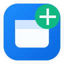

# HoldTab - Background Link Opener & Gesture Tab Suite

> Effortlessly open links in background tabs, switch tabs at lightning speed, search current websites or Google, and manage clipboard actions using fluid mouse gestures, trackpad scrolling, and keyboard shortcuts.



[](manifest.json)
[](manifest.json)
[](#installation-guide)
[](#privacy--permissions)
[](LICENSE)

---

## Why HoldTab?

When researching, reading articles, or browsing forums (Reddit, Hacker News, GitHub), opening links in background tabs keeps your focus intact. However:
- **Middle-clicking** is stiff and awkward on laptop trackpads or office mice.
- **Ctrl + Click** demands taking a hand off your mouse or trackpad.
- **Switching tabs** usually requires hunting across crowded tab bars.
- **Copying, cutting, or searching text** requires tedious context menu navigation or repeated keyboard combinations.

**HoldTab** solves all of this with intuitive, non-intrusive gestures:
1. **Press and hold on any link** for a brief moment (default: 450ms) &mdash; an animated radial ring fills around your cursor and opens the link in a background tab without leaving your current page.
2. **Contextual Floating Text Selection Toolbar** &mdash; whenever you highlight text, an elegant floating toolbar appears with **Select Line**, **Search** (with multi-engine hover submenu for background and foreground tabs), **Copy**, and **Cut**.
3. **Cycle tabs effortlessly** using <kbd>Alt</kbd> + <kbd>&lt;</kbd> / <kbd>&gt;</kbd>, two-finger trackpad scroll, mouse wheel, or rocker clicks.
4. **Supercharge text selections** with instant double-click copy/cut, smart spaced paste, and direct site or Google search hold gestures.

---

## Quick Reference: Gesture & Color Cheat Sheet

| Gesture | Action | Visual Feedback | Target Tab |
| :--- | :--- | :--- | :--- |
| **Highlight Text (Toolbar)** | Floating contextual action toolbar | 🪄 **Floating Toolbar** (Select Line, Search, Copy, Cut) | In-page / Background |
| **Click Website on Submenu** | Search query in background (keeps menu open) | 🌐 **Submenu Grid**: `✓ Opened` badge | Background (Stay) |
| **Click `↗` Icon on Website**| Search query & switch immediately | 🚀 Immediate tab switch | Active Foreground |
| **Hold Left-Click on Link** | Open link in background | 🔵 **Sky Blue Ring** + Checkmark | Background (Stay) |
| **Hold Right-Click on Link** | Open link & switch immediately | 🟣 **Indigo Ring** + Checkmark | Active Foreground |
| **Flick / Drag Link** | Fast flick link in any direction | 🧭 **Directional Arrow** | Background (Stay) |
| **Hold Left-Click on Selected Text** | Search query on Google | 🟡 **Amber Ring** | Background (Stay) |
| **Hold Right-Click on Selected Text** | Search query on Google | 🟣 **Purple Ring** | Active Foreground |
| **Alt + Hold Left-Click on Text** | Search current website | 💠 **Cyan Ring** | Current Tab |
| **Alt + Hold Right-Click on Text** | Search current website | 🟢 **Teal Ring** | New Foreground Tab |
| **Alt + Double Left-Click on Text** | Fill site search bar (no submit) | 🔍 Search bar autofill & focus | Current Tab |
| **Double Left-Click on Selected Text** | Instant Copy | 📋 Floating HUD: `Copied` | Clipboard |
| **Double Right-Click on Selected Text** | Instant Cut (Inputs/Textareas) | ✂️ Floating HUD: `Cut` | Clipboard |
| **Double Left-Click in Input Field** | Smart Paste (with word spacing) | 📋 Floating HUD: `Pasted` | Input field |
| **Alt + `<` (Prev) or `>` (Next)** | Cycle to previous / next tab | 🧭 Floating HUD: Tab Title `[2/5]` | Previous / Next Tab |
| **Alt + Two-Finger Scroll** | Smooth trackpad tab cycling | 🧭 Floating HUD: Tab Title `[2/5]` | Previous / Next Tab |
| **Right-Click + Wheel Scroll** | Mouse wheel tab cycling | 🧭 Floating HUD: Tab Title `[2/5]` | Previous / Next Tab |
| **Rocker Gestures** | Hold L + Click R (Next) / Hold R + Click L (Prev) | ⚡ Fast binary tab switch | Previous / Next Tab |
| **Double Right-Click on Empty Space**| Instantly close active tab | ❌ Floating HUD: `Closing Tab...`| Active Tab |

---

## Features Breakdown

### 1. 🔗 Hyperlink Gestures
- **Long-Press Hold (Background Tab)**: Press and hold down the left mouse button on any link. A Sky Blue progress ring completes around your cursor, pulses green with a checkmark, and opens the link in the background without navigating away.
- **Right-Click Hold (Foreground Tab)**: Press and hold the right mouse button on any link to open it in a new tab and switch to it immediately (Indigo ring). Context menu is cleanly suppressed.
- **Quick Flick / Drag Mode**: Flick or drag any link in any direction. A dynamic directional arrow tracks your cursor with a live distance ring. Passing your threshold (default: 35px) triggers the background tab immediately without waiting for a timer!
- **Zero Interference & Click Suppression**: Releasing before completion or moving > 8px cancels the gesture immediately, preserving standard clicks and text selection. When hold completes, the subsequent click is suppressed so the current page never navigates.
- **Activation Modifier Keys**: Optionally require holding <kbd>Alt</kbd>, <kbd>Ctrl</kbd>/<kbd>Cmd</kbd>, or <kbd>Shift</kbd> to activate link gestures.
- **Tab Placement Control**: Choose whether new tabs open **Next to active tab** (`index + 1`) or **At the end** of your tab strip.

---

### 2. 🪄 Floating Text Selection Toolbar & Search Submenu
- **Automatic Contextual Presence**: Whenever you select text across webpages, a compact, frosted-glass floating toolbar automatically appears above (or below) your selection after a calibrated debounce (~250ms).
- **Core Action Suite**:
  - **Select Line**: Selects the full line / sentence containing the selected word (rather than the entire document), and repositions the toolbar on the newly selected line for quick follow-up copying or searching.
  - **Search**: Clicking Search directly executes a Google search in a background tab without leaving your reading position.
  - **Multi-Engine Search Submenu**: Hovering over the Search button opens a smooth secondary floating submenu with instant access to:
    - 🔍 **Google**
    - 📺 **YouTube**
    - 📚 **Wikipedia**
    - 👾 **Reddit**
    - 🐙 **GitHub**
    - 🛒 **Amazon**
    - ➕ **Custom Search Engines** (SteamDB, Steam, Nexus Mods, GOG, or any custom URL).
    - **Consecutive Background Searching**: Clicking any website button opens the search in a **background tab** while **keeping the toolbar and menu open**, so you can search the query on multiple websites back-to-back!
    - **Instant Foreground Switch**: Each website button features a dedicated **`↗` icon** on the right side &mdash; clicking it opens the search in an **active foreground tab** and immediately switches to it.
  - **Copy**: Copies the highlighted text to your clipboard with immediate "Copied!" feedback and HUD confirmation.
  - **Cut**: Intelligently handles cut operations. In editable inputs or textareas, cuts text natively. On standard read-only web content, Cut is visually dimmed with an accessible explanatory toast (`"Cut is only available in editable fields"`).
- **Complete Display Control**:
  - **Automatic Mode**: Appears automatically on selection after configurable delay (0&ndash;600ms, default 250ms) and minimum text length (default: 2 characters).
  - **On Demand Mode**: Displays only when holding your preferred modifier key (<kbd>Alt</kbd>, <kbd>Ctrl</kbd>, or <kbd>Shift</kbd>).
  - **Disabled Mode**: Completely disables toolbar without affecting mouse gestures.
- **Zero Obstruction & Safety Rules**: Automatically suppressed inside password fields, standard input boxes, and textareas so it never blocks web forms or native editing.
- **Shadow DOM Style Isolation**: Rendered inside an isolated Shadow DOM host (`#holdtab-toolbar-host`) to ensure zero CSS contamination with host website styles.
- **Keyboard Accessible**: Full support for <kbd>Tab</kbd>, Arrow keys, <kbd>Enter</kbd> / <kbd>Space</kbd> activation, and <kbd>Escape</kbd> dismissal.

---

### 3. 🔍 Selected Text Gestures & Instant Clipboard Suite
- **Double Left-Click to Copy**: Highlight text on any page and double left-click on it to instantly copy it to your clipboard. Shows a sleek floating green `📋 Copied` HUD badge. *(Triple-clicking smoothly selects full paragraphs without triggering copy).*
- **Double Right-Click to Cut**: Highlight text inside any editable input field or textarea and double right-click (or triple left-click) to cut it to the clipboard with an instant `✂️ Cut` notification.
- **Smart Paste with Word Spacing**: Double left-click inside an empty input field, between words, or at field boundaries to paste clipboard content with intelligent spacing. Native double-click word selection inside words is preserved.
- **Current Website Search**:
  - **Alt + Hold Left-Click (Cyan Ring)**: Automatically detects the website's search bar, fills your selected query, and submits the search in the current tab.
  - **Alt + Hold Right-Click (Teal Ring)**: Opens a new tab with the current website and automatically runs the search there.
  - **Alt + Double Left-Click**: Fills the current site's search bar and places the cursor focus there without auto-submitting, allowing you to edit the query.
- **Global Google Web Search**:
  - **Hold Left-Click (Amber Ring)**: Highlight text and hold left-click (~450ms) to search Google in a new background tab.
  - **Hold Right-Click (Purple Ring)**: Highlight text and hold right-click (~450ms) to search Google and switch to the new tab immediately.
- **Deselection Safety**: Gestures strictly verify that text is currently selected. If you deselect or click away, selected text gestures never accidentally trigger.

---

### 4. 🔄 Tab Cycling & Multi-Tab Navigation
- **Keyboard Tab Hopping (<kbd>Alt</kbd> + <kbd>&lt;</kbd> and <kbd>Alt</kbd> + <kbd>&gt;</kbd>)**:
  - Press <kbd>Alt</kbd> + <kbd>&lt;</kbd> (Comma / `<`) to jump to the **Previous Tab** (`◀`).
  - Press <kbd>Alt</kbd> + <kbd>&gt;</kbd> (Period / `>`) to jump to the **Next Tab** (`▶`).
  - Supports both **Left Alt** and **Right Alt / AltGr**. Includes a dedicated toggle in settings.
- **Smooth Trackpad Two-Finger Scroll (<kbd>Alt</kbd> + Scroll)**:
  - Hold *either* <kbd>Left Alt</kbd> or <kbd>Right Alt</kbd> and scroll two fingers up/down or swipe left/right on your laptop trackpad.
  - Built-in anti-chatter friction smoothing prevents runaway skipping across tabs.
  - Native Windows Alt menu bar suppression prevents focus from getting trapped in browser menus.
- **Rocker Gestures (Zero Mouse Movement)**:
  - **Next Tab (`▶`)**: Hold down the **Left Mouse Button** and tap/click the **Right Mouse Button**.
  - **Previous Tab (`◀`)**: Hold down the **Right Mouse Button** and tap/click the **Left Mouse Button**.
- **Right-Click + Wheel Scroll**:
  - Hold down the **Right Mouse Button** anywhere on the page and roll your scroll wheel **Down** (Next Tab) or **Up** (Previous Tab).
- **Right-Click + Swipe Gestures**:
  - Hold down the **Right Mouse Button** and swipe horizontally.
  - **🖱️ Mouse Mode**: Swipe Right (➔ Next Tab), Swipe Left (⬅ Prev Tab).
  - **💻 Mousepad Mode**: Swipe Left (⬅ Next Tab), Swipe Right (➔ Prev Tab) (natural trackpad flow).
- **Double Right-Click to Close Tab**:
  - Rapidly double right-click anywhere on empty space to close the active tab. Context menus are cleanly blocked.
- **Visual Tab HUD Pill**:
  - A sleek floating HUD pill displays destination tab title, navigation direction arrow, or close status (e.g. `[2/5] GitHub • Pull Requests`).

---

### 5. ✨ Visuals & Customization Suite
The extension settings popup provides granular control across 6 dedicated panels:
- **Links Tab**: Trigger mode (Hold, Flick, Both), Flick distance (15px&ndash;100px), Activation key, Tab placement, Default focus, and the Live Test Arena.
- **Tabs Tab**: Toggles for Alt scroll, Alt + &lt; / &gt; keys, Rocker gestures, Right-Click wheel, Right-Click swipe (with Mouse vs. Mousepad mode), and Tab HUD.
- **Shortcuts Tab**: Toggles for Double-Click copy/cut, Smart paste, Alt double-click fill search, Alt hold site search, Text hold Google search, and Double right-click tab close.
- **Toolbar Tab (`🪄`)**: Master toolbar toggle, Display mode (Automatic, On Demand with modifier key, Disabled), Appearance delay slider (0&ndash;600ms), Minimum selection length slider (1&ndash;10 chars), Search submenu toggle, and complete **Search Engines Manager**:
  - **🎯 Capture Search URL Automatically (Recommended)**: Add any website search engine without editing parameters or knowing about `{query}`. HoldTab generates a unique test marker, lets you search on the website, automatically captures the active tab URL, detects query or path search parameters, shows a live preview with background tab testing, and safely saves to your toolbar submenu.
  - **✏️ Enter Manually**: Traditional manual template editor for power users or sites where URL parameters cannot be auto-detected.
  - **Reorder & Management**: Reorder engines with ▲/▼, edit templates, toggle on/off, and 1-click restore defaults.
- **Visuals Tab**:
  - **Link Hold Ring**: Independent toggle, Hold duration slider (200ms&ndash;1200ms), Grace delay slider (0ms&ndash;600ms).
  - **Site Search Ring**: Independent toggle, Hold duration slider, Grace delay slider.
  - **Web Search Ring**: Independent toggle, Hold duration slider, Grace delay slider.
  - **Other Visuals**: Toggles for flick directional arrow and floating HUD badges.
- **Sites Tab**: Domain blacklist with 1-click **+ Exclude This Site** button and custom domain management.

---

## Interactive Practice Playground (`test.html`)

HoldTab includes a built-in, playful **Practice Playground** to test every gesture safely without leaving your browser:
- **Accessing the Guide**:
  1. Click the HoldTab icon in your browser toolbar to open settings.
  2. Click **"📖 Open Interactive Practice Guide"** at the bottom of the Links tab, or open `test.html` directly in your browser (`file:///path/to/test.html`).
- **Interactive Practice Sandbox**:
  - **1. Interactive Test Links**: Try background hold (Sky Blue), foreground hold (Indigo), and flick/drag (Cyan) with clear instruction pills below each button.
  - **2. Floating Selection Toolbar**: Highlight demo sentences to test the floating toolbar, hover over Search to explore the search engine grid, test Copy and Cut, and verify excluded password/input contexts.
  - **3. Interactive Text Sandbox**: Highlight sample text with **Quick Select Sample Text**, test **Deselect / Unselect Text**, cut/copy text in live input boxes, test smart paste in empty fields, and execute live search queries in an embedded test form.
  - **4. Tab Cycling Practice**: Practice trackpad scroll, keyboard keybinds (<kbd>Alt</kbd> + <kbd>&lt;</kbd> / <kbd>&gt;</kbd>), wheel scroll, and rocker gestures with on-screen HUD feedback.
  - **5. Safety Check**: Verify standard buttons and UI elements operate normally without HoldTab interference.

---

## Installation Guide

### For Brave, Google Chrome & Microsoft Edge (Chromium)
1. Clone or download this repository:
   ```bash
   git clone https://github.com/rockypagal/link_gestures_browser_extension.git
   ```
2. Open your browser and navigate to:
   - **Brave**: `brave://extensions`
   - **Chrome**: `chrome://extensions`
   - **Edge**: `edge://extensions`
3. Toggle on **Developer mode** in the top-right corner.
4. Click **Load unpacked**.
5. Select the repository root folder containing `manifest.json`.
6. Pin **HoldTab** to your browser toolbar for quick settings access!

---

### For Mozilla Firefox

HoldTab is fully compatible with Firefox Manifest V3 and uses dual background script and service worker declarations.

#### Temporary Add-on (Development)
1. Open Firefox and go to `about:debugging#/runtime/this-firefox`.
2. Click **Load Temporary Add-on...**.
3. Select the `manifest.json` file inside the repository folder.
4. HoldTab is immediately loaded and active.

#### Release Packaging (Firefox Add-ons / AMO)
To generate a certified zip file for upload to the [Firefox Add-on Developer Hub](https://addons.mozilla.org/developers/):
```bash
node scripts/package.js
```
This script automatically:
- Syncs the version from `manifest.json` into `popup/popup.html`.
- Uses forward-slash paths compliant with Mozilla Add-on store validation.
- Packages all necessary assets into `holdtab-firefox.zip` in the project root.

---

## Repository Structure

```
├── manifest.json              # Manifest V3 extension configuration
├── holdtab-firefox.zip        # Release package ready for Firefox AMO
├── background/
│   └── service-worker.js     # Background tab creation, cycling, & clipboard APIs
├── content/
│   ├── content.js            # Gesture engine, radial SVG rings, event handlers
│   └── content.css           # Radial countdown overlays & floating HUD styles
├── popup/
│   ├── popup.html            # Settings UI & interactive live-test arena
│   ├── popup.js              # Real-time settings sync & test arena logic
│   └── popup.css             # Modern dark theme styles
├── icons/
│   ├── icon-16.png           # 16x16 icon
│   ├── icon-48.png           # 48x48 icon
│   └── icon-128.png          # 128x128 icon
├── scripts/
│   ├── generate-icons.js     # Zero-dependency PNG generator script
│   └── package.js            # Automated packaging script for Firefox AMO
├── test.html                 # Interactive gesture practice playground
├── test.js                   # Interactive playground event handlers
├── CHROMEWEBSTORE.md         # Store listing metadata and review checklist
├── .gitignore                # Git ignore rules (tracks holdtab-firefox.zip)
└── README.md                 # Complete documentation & usage guide
```

---

## Privacy & Permissions

HoldTab adheres strictly to the highest privacy standards:
- **`storage`**: Used exclusively to store your personal gesture preferences, timers, and domain exclusion blacklist locally on your machine.
- **`tabs`**: Used to open background/foreground tabs, cycle active tabs, and close tabs upon gesture completion.
- **`clipboardRead`**: Required for the Double Left-Click Smart Paste gesture in input fields.
- **100% Local**: Zero tracking, zero telemetry, and zero outbound network requests. All gesture detection and logic run entirely within your local browser.

---

## Contributing & Bug Reports

Contributions, suggestions, and feature requests are welcome!
1. Fork the repository.
2. Create your feature branch (`git checkout -b feature/amazing-feature`).
3. Commit your changes (`git commit -m "feat: add amazing feature"`).
4. Push to the branch (`git push origin feature/amazing-feature`).
5. Open a Pull Request.

---

## License

This project is licensed under the [MIT License](LICENSE).
